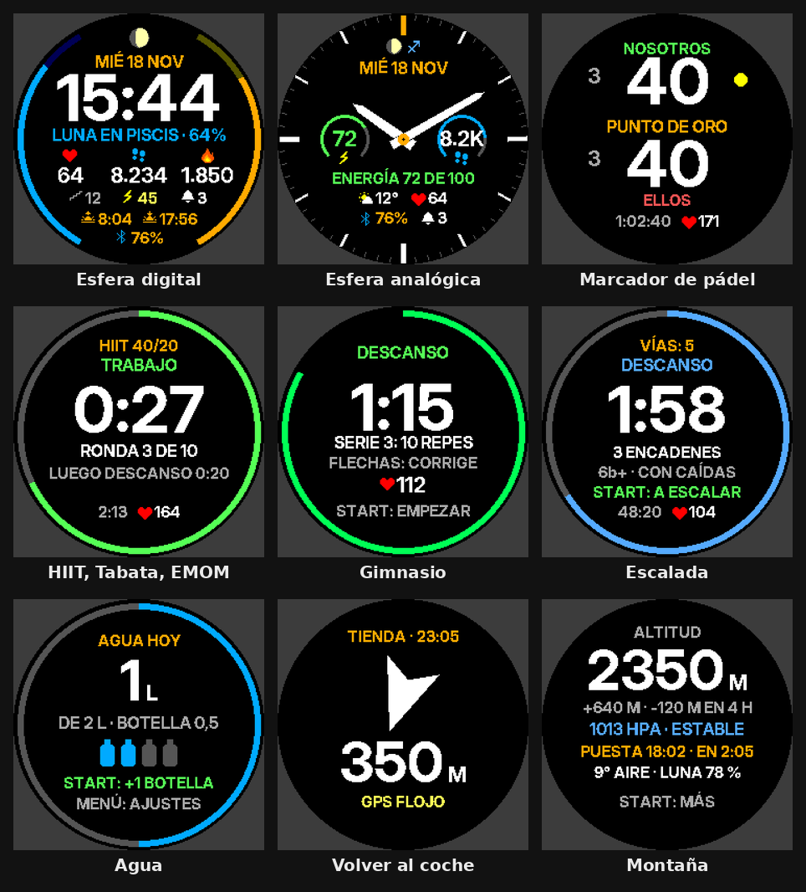

# Vibecodea tu Garmin

Una skill para Claude que te ayuda a sacarle el máximo partido a tu reloj Garmin con esferas, widgets y apps hechas a tu medida, aunque no hayas programado nunca. Claude investiga tu modelo, te propone ideas, escribe el código, lo comprueba y te guía para instalarlo.



## Qué hace

- **Investiga tu reloj:** sus sensores, su pantalla, lo que ya trae de serie y lo que permite su versión de Connect IQ. Con eso te enseña un mapa de lo que puedes añadir. Un reloj con más sensores da para más, y la skill lo aprovecha.
- **Una esfera a tu gusto**, solo con los datos que te importan y explicados en palabras normales.
- **Deportes que tu reloj no trae:** marcador de pádel, HIIT, Tabata, EMOM, comba, boxeo o escalada.
- **Widgets:** agua, pendientes, montaña o volver al coche.
- **Tus números de salud juntos:** en relojes modernos, pone en tu esfera el Body Battery, el sueño o la recuperación que ya calcula Garmin; en los antiguos, puede estimarlos.

No rehace lo que tu reloj ya hace: te lo dice.

## Qué necesitas

- Un **ordenador** (Mac, Windows o Linux) y el **cable** de tu reloj.
- Una **cuenta de Claude**. Vale la gratuita.
- Una **cuenta de Garmin** (gratis) para descargar el kit oficial de Connect IQ. Claude te dice dónde.
- **Tiempo:** la primera vez, cuenta con una o dos horas.

No hace falta saber programar: Claude te va diciendo qué hacer en cada momento.

## Paso a paso

### 0. Si nunca has usado Claude

1. Crea una cuenta en [claude.ai](https://claude.ai).
2. Mejor aún, descarga la [app de escritorio de Claude](https://claude.ai/download). Si le das acceso a tu ordenador, puede hacer por ti los pasos técnicos.
3. En **Configuración > Capacidades**, activa **«Crear y editar archivos»**. En algunas cuentas se llama «Ejecución de código y creación de archivos».

### 1. Descarga la skill

En tu ordenador, descarga **[vibecodea-tu-garmin.zip](vibecodea-tu-garmin.zip?raw=true)**. No lo descomprimas.

Si usas Safari y te lo descomprime solo, desmarca en **Safari > Ajustes > General** la opción de abrir los archivos «seguros» al descargarlos y vuelve a bajarlo, o usa otro navegador.

### 2. Súbela a Claude

Ve a **Personalizar > Habilidades**, pulsa **+**, luego **+ Crear habilidad** y **Cargar una habilidad**, y elige el zip.

Si tienes Claude en inglés: *Customize > Skills > + > Create skill > Upload a skill*.

### 3. Escríbele

Por ejemplo: «Quiero vibecodear mi Garmin Forerunner 265. No sé programar». Claude te hará unas preguntas y empezará por investigar tu reloj.

### Si usas Claude Code

Descarga el zip y descomprímelo en tu carpeta de skills:

```bash
unzip vibecodea-tu-garmin.zip -d ~/.claude/skills/
```

## Cómo funciona

1. **Entrevista corta:** tu modelo exacto, tu ordenador, qué haces y qué quieres ver.
2. **Investiga tu reloj** y te enseña su mapa de posibilidades: qué ya trae, qué se le puede añadir y lo difícil que es.
3. **Eliges** por dónde empezar.
4. **Prepara tu ordenador:** Java, el kit oficial de Garmin y tu clave de desarrollador.
5. **Construye** pieza a pieza, partiendo de ejemplos que ya funcionan en un reloj real.
6. **Lo revisa:** que compile, que nada se salga de la pantalla y que no gaste batería de más.
7. **Te guía para instalarlo** por cable.
8. **Te deja una chuleta** con qué hace cada botón y qué significa cada número.

## ¿Es seguro?

- **El zip solo tiene texto:** instrucciones para Claude, código de ejemplo y scripts pequeños que puedes abrir y leer. Al descargarlo no se ejecuta nada.
- **No se toca el firmware.** Son apps hechas con las herramientas oficiales de Garmin, como las de cualquier desarrollador. Para quitarlas, basta con borrar el archivo.
- **Tu clave de desarrollador se queda en tu ordenador.** No la subas a internet ni la compartas.
- **Las métricas de salud son estimaciones** para ver tendencias, no un diagnóstico.
- **La nube es opcional.** Si decides guardar tus datos fuera del reloj, van a tu propio servidor.

## Preguntas frecuentes

**¿Sirve para mi reloj?** Para casi cualquier Garmin con Connect IQ: Forerunner, fēnix, Epix, Venu, Vivoactive, Instinct, Enduro… Los ejemplos están probados en un fēnix 5, y Claude adapta el diseño a tu pantalla. Si tu modelo no admite Connect IQ, te lo dirá al principio.

**¿Puedo romper el reloj?** No. Son apps normales, que el reloj ejecuta en un espacio cerrado sin acceso al sistema. Lo peor que puede pasar es que una falle o gaste más batería, y se quita borrando su archivo.

**Tengo Mac y mi reloj no aparece al enchufarlo.** Si tu reloj tiene música, usa MTP y el Mac no lo ve. Instala OpenMTP (gratis) y cierra Garmin Express antes de copiar. La skill te lo explica paso a paso.

**¿Cuesta dinero?** El kit de Garmin es gratis y las skills funcionan en todos los planes de Claude, también el gratuito. Un proyecto así lleva bastantes mensajes, así que con el plan gratis quizá tengas que repartirlo en varios días.

**Claude no usa la skill.** Comprueba que está activada en **Personalizar > Habilidades** y pídeselo con todas las letras: «Usa la skill vibecodea-tu-garmin».

**Me he atascado.** Cuéntaselo a Claude en la misma conversación, con el error tal cual: la skill incluye los fallos habituales y cómo arreglarlos. Es un proyecto gratuito y no hay soporte personal.

## Qué hay en el zip

```
vibecodea-tu-garmin/
├── SKILL.md          lo que lee Claude
├── references/       entrevista, investigar el reloj, sacarle partido, Monkey C, esferas, instalar…
├── scripts/          compilar, crear la clave, ficha del reloj, generar fuentes
└── ejemplos/fenix5/  11 apps reales (esferas, widgets y deportes) y un servidor de ejemplo
```

## Licencias

- Código y textos: licencia MIT (ver `LICENSE`).
- Las fuentes de los ejemplos están generadas a partir de [Inter](https://rsms.me/inter/) (SIL Open Font License 1.1) y DejaVu Sans (licencia libre de Bitstream Vera y DejaVu).
- Proyecto independiente, sin relación con Garmin. Garmin, fēnix, Forerunner, Venu, Instinct y Connect IQ son marcas de Garmin Ltd. o sus filiales.
